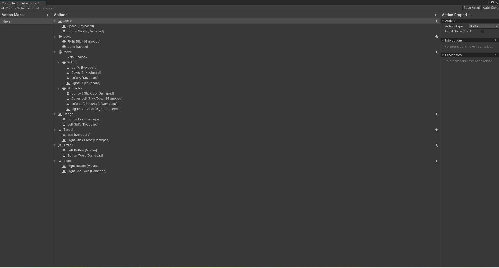

# ⚔️ Unity Fanatsy

> **Tóm tắt:** Dự án xây dựng hệ thống chiến đấu góc nhìn thứ ba kết hợp điều khiển trạng thái nhân vật trong Unity.

## 📸 Video Demo thực tế
* 🔗 **Video Gameplay** [https://youtu.be/PpO8mFtgnKE]

## 🛠️ Công nghệ sử dụng
* **Engine:** Unity `2022.3.x LTS`
* **Ngôn ngữ:** C#
* **Hệ thống & Thư viện:** Unity Input System,Animator Controller, NavMesh,FSM,GOAP
* **Quản lý phiên bản:** Git & GitHub (Git LFS)
* **🛠️Hình ảnh Công nghệ FSM
* Player:
  
  
  
  
  
  
  *Emeny:
  
  
  
  
## 🚀 Hướng dẫn trò chơi
Các nút ấn cho player

